# ResolveIQ

**Issue and incident management, from "something is broken" to "confirmed fixed, on time".**

People report problems. A manager hands each one to the right person and sets how urgent it is. A clock starts counting down to a deadline (the SLA). The person who reported it confirms the fix. Everything that happens is recorded.

[](https://github.com/gademeghana20/ResolveIQ/actions/workflows/ci.yml)


### Live demo: **<https://resolve-iq.vercel.app>**

Open it and click **Employee**, **Manager** or **Admin** on the sign-in page. No sign-up and no password needed.

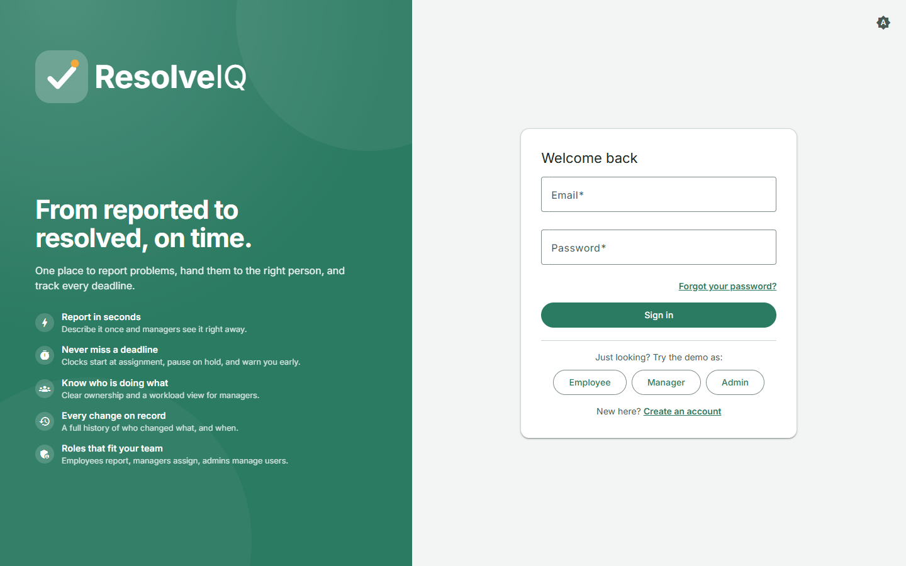

**About this project:** I'm Meghana Gade, and I built ResolveIQ on my own as a full-stack portfolio project: an issue and incident management system with role-based access, SLA tracking and file attachments. It is an independent project. It uses no employer code, data or credentials, and everything in the demo is made up.

**Built with**

- **Front end:** Angular 21 (standalone components, signals), Angular Material, AG Grid, TypeScript, RxJS
- **Back end:** ASP.NET Core on .NET 10, C#, a layered design (API, Application, Domain, Infrastructure), REST with OpenAPI
- **Data:** Entity Framework Core 10, SQL Server, code-first migrations
- **Security:** JWT sign-in with refresh tokens, role-based permissions (Employee, Manager, Admin), rate limiting, security headers, an audit log, file uploads checked by extension and contents
- **Testing:** 600+ xUnit tests (including a role-by-endpoint permission matrix), 700+ Vitest tests, Playwright browser tests, axe accessibility scans (WCAG 2.1 A and AA)
- **DevOps:** GitHub Actions CI, free hosting (Vercel for the website, MonsterASP.NET for the API and database), Postman collection, Mermaid diagrams

---

## Contents

1. [Try the live demo](#1-try-the-live-demo)
2. [What the app does](#2-what-the-app-does)
3. [How an incident moves through the system](#3-how-an-incident-moves-through-the-system)
4. [The three roles](#4-the-three-roles): Employee, Manager, Admin
5. [Who can do what](#5-who-can-do-what)
6. [Every feature, by area](#6-every-feature-by-area)
7. [Architecture](#7-architecture)
8. [Security](#8-security)
9. [Testing and quality checks](#9-testing-and-quality-checks)
10. [Run it on your computer](#10-run-it-on-your-computer)
11. [Settings reference](#11-settings-reference)
12. [Deploying it](#12-deploying-it)
13. [Project layout](#13-project-layout)
14. [API and Postman](#14-api-and-postman)
15. [Known limits, and what was left out on purpose](#15-known-limits-and-what-was-left-out-on-purpose)
16. [Licence](#16-licence)

---

## 1. Try the live demo

**<https://resolve-iq.vercel.app>**

| Button | Signs you in as | Try this |
|---|---|---|
| **Employee** | `employee@example.com` | See only your own incidents. Open the resolved one and read how it was fixed. Report a new incident. Open the bell. |
| **Manager** | `manager@example.com` | See every incident. Assign the unassigned ones. Open the overdue one. Look at the dashboard. Export a CSV. |
| **Admin** | `admin@example.com` | Everything a manager can do, plus the **Admin** area: users, categories, SLA deadlines and the audit log. |

Things worth knowing before you click around:

- **The data is made up.** 14 invented incidents and 7 invented people (`@example.com` addresses). Nothing real is stored.
- **Everybody shares the three demo accounts.** What you change, the next visitor sees. The three shared accounts are protected: nobody can change their password, change their role or deactivate them, so the demo keeps working for everyone.
- **Registration is switched off** on the live site, so strangers cannot fill the database with accounts.
- **It runs on free hosting.** The first click after a quiet period can take a few seconds.
- **No real email is sent.** "Forgot password" is switched off for the demo accounts, and the app only writes emails to its log (see [known limits](#15-known-limits-and-what-was-left-out-on-purpose)).
- **File attachments are switched off on the live demo**, so strangers cannot put files on a site that is not theirs. Everything else about files works, and you can try uploading by [running the app on your computer](#10-run-it-on-your-computer) (attachments are on by default there).

---

## 2. What the app does

| The problem | How ResolveIQ answers it |
|---|---|
| "Who is handling this?" | Every incident has one owner. The incident list and a workload table show who has what. |
| "Is it urgent?" | The reporter gives a hint. The **manager** decides the real priority. |
| "Will we miss the deadline?" | Each priority has a deadline (the SLA). A clock starts when the incident is assigned, pauses while it is on hold, and warns when 25% or less of the time is left. |
| "Was it actually fixed?" | The assignee writes **how it was fixed**. The **reporter** confirms and closes it, or reopens it. If nobody answers, it closes by itself after 7 days. |
| "Who changed what?" | Every incident has a full history. The Admin area has a separate audit log. Both are written by the system and cannot be edited. |
| "Can I see the big picture?" | A dashboard with numbers and charts for right now and for the last 7, 30 or 90 days. |
| "Can I show what I mean?" | **Attach screenshots, PDFs and text files** to an incident or to a comment. They stay private to the people who can see that incident. |

---

## 3. How an incident moves through the system

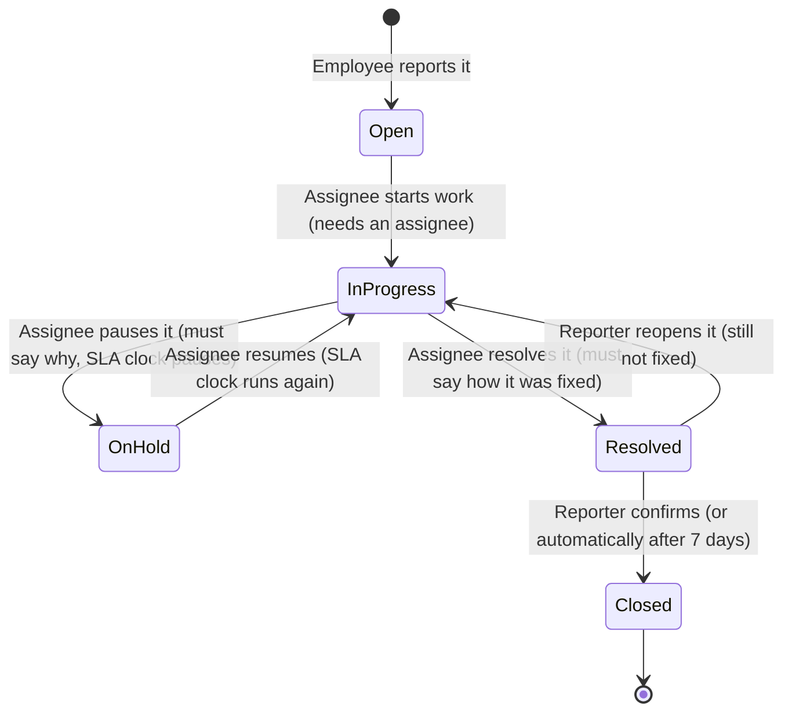

- **Closed is final.** A closed incident cannot be edited, assigned, reprioritised or reopened.
- **A Manager or Admin can step in for anyone.** If the assignee or reporter is away, a Manager or Admin can make the move for them. The screen labels it "(on behalf of name@example.com)", and the history records who really did it.
- **Assigning is the Manager's job.** The first assignment also sets the priority, and **that is when the SLA clock starts**.

### How the SLA (deadline) works

| Priority | Default time to resolve |
|---|---|
| Critical | 4 hours |
| High | 8 hours |
| Medium | 24 hours |
| Low | 48 hours |

An Admin can change these hours, or switch a priority off so its incidents get no deadline.

- The clock **starts at the first assignment**, and **restarts if the priority is changed** while the incident is still being worked.
- The clock **pauses while the incident is On hold** and while it is Resolved. Paused time never counts against the deadline.
- Each incident **keeps the hours it was promised**. Changing the SLA policy later only affects incidents whose clock starts afterwards.
- A finished incident keeps its result for good: **Met** (resolved in time) or **Breached**.
- Priority cannot be changed once an incident is Resolved or Closed, so nobody can rewrite an SLA result afterwards.

| SLA state | Meaning |
|---|---|
| **Not started** | Not assigned yet, so no clock. |
| **On track** | Clock running, more than 25% of the time left. |
| **At risk** | Clock running, 25% or less of the time left. |
| **Paused** | On hold. |
| **Breached** | Past the deadline. Shown as "Overdue by 1 d 8 h". |
| **Met** | Resolved on or before the deadline. |
| **No SLA** | Its priority had no deadline when the clock started. |

---

## 4. The three roles

### Employee: "I have a problem, and I want to know it gets fixed"

**Purpose:** report problems, follow them, and confirm when they are really solved. An Employee sees **only the incidents they reported or that are assigned to them**.

| What they do | Detail |
|---|---|
| **Report an incident** | Title (up to 200 characters), description (up to 4000), an optional category, and an optional **"How urgent is this for you?"** hint. The hint helps the manager, who still sets the real priority. |
| **Follow their incidents** | A list with search, filters (status, priority, category, SLA) and quick toggles: **All / Assigned to me / Reported by me / Unassigned**. Each row shows priority, status and the SLA time left. |
| **Read the answer** | When an incident is resolved, a **"How it was fixed"** box explains what was done. |
| **Confirm or reopen** | A banner asks **"Is it fixed?"**. **Close incident** confirms it. **Reopen** sends it back to work. If nobody answers, it closes automatically after 7 days. |
| **Edit their own report** | Change the title and description until the incident is closed. |
| **Attach files** | Add screenshots, PDFs or text files: while reporting, later on the incident page, or together with a comment. Up to 5 MB each. They can download any file on an incident they can see, and remove their own. |
| **Comment** | Add notes to the conversation. Comments are a permanent record and cannot be edited or deleted. |
| **Get notified** | A bell shows what happened on their incidents (assigned, status changes, comments, resolved, reopened, closed, closed automatically). |
| **See their own numbers** | A dashboard of their own incidents, including a **"Waiting for your confirmation"** tile for incidents that need their answer. |
| **Export** | Download their incident list as a CSV file. |
| **Look after their account** | Change their password, switch Light / Dark / System theme. |

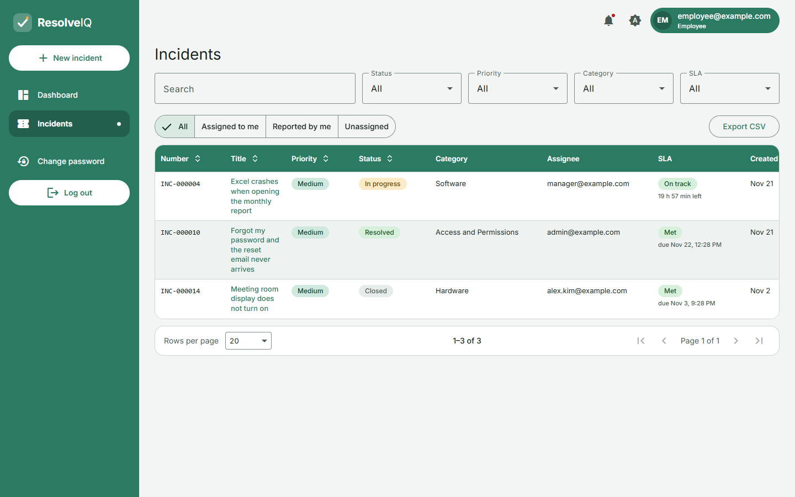

| Report an incident | Confirm that it is fixed |
|---|---|
| 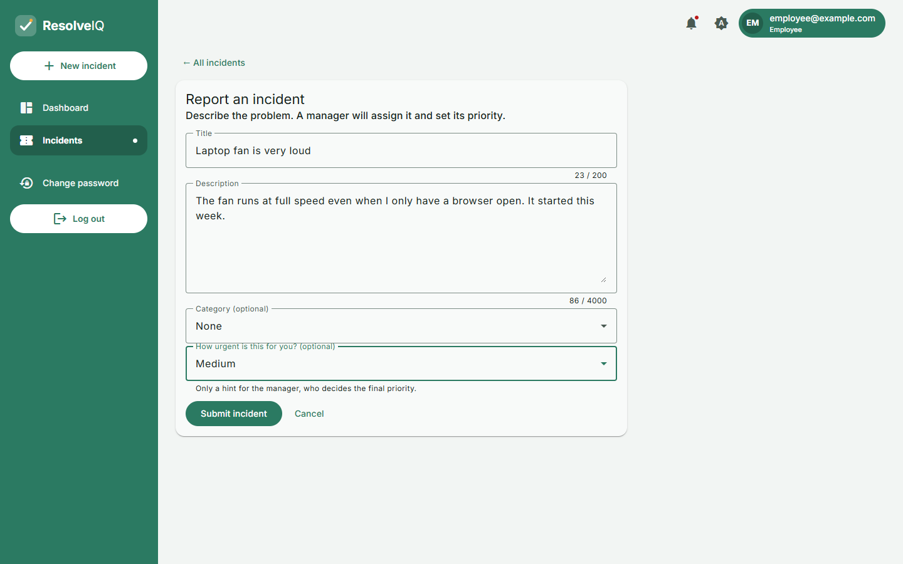 | 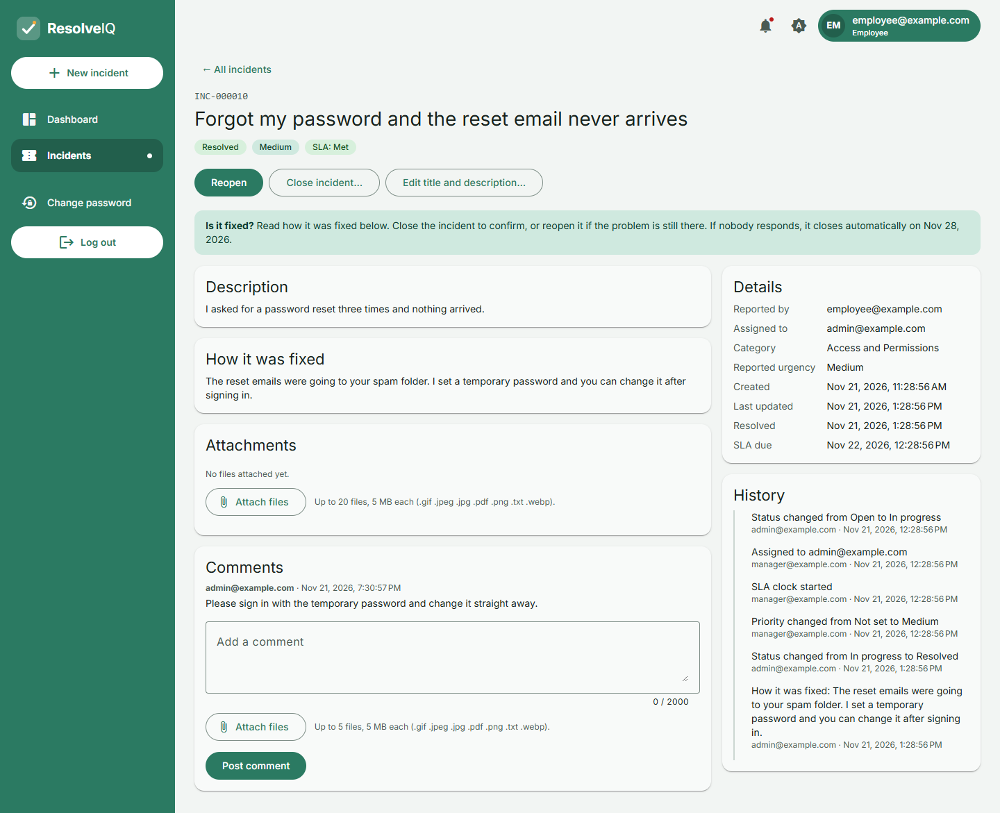 |

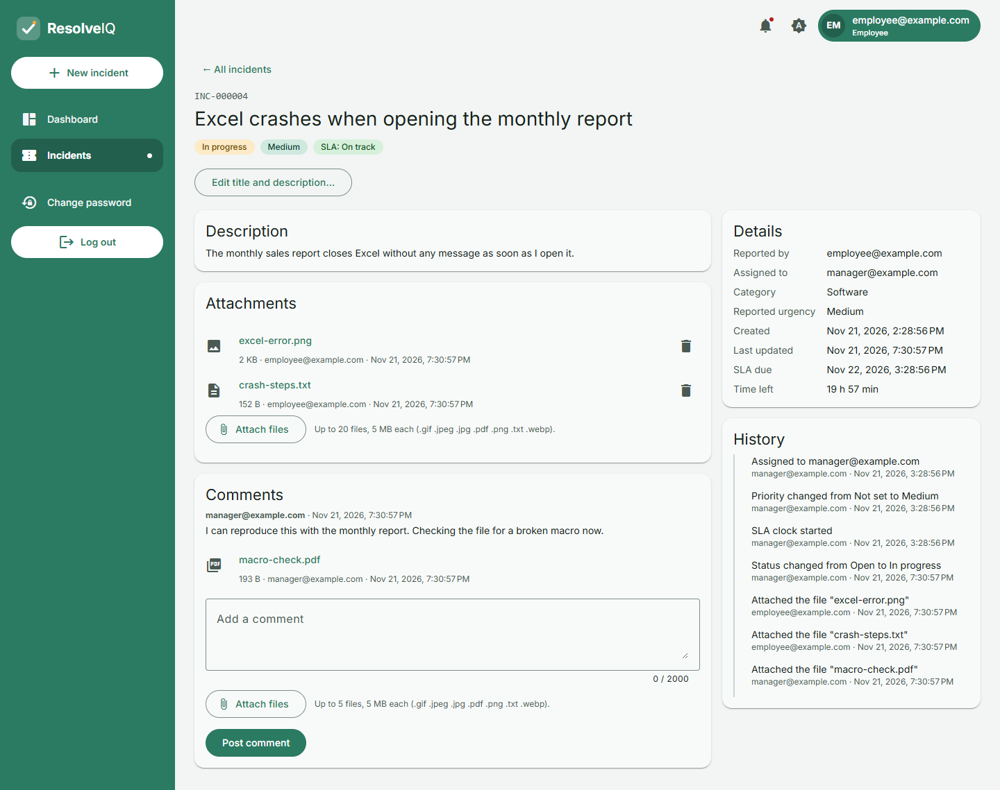

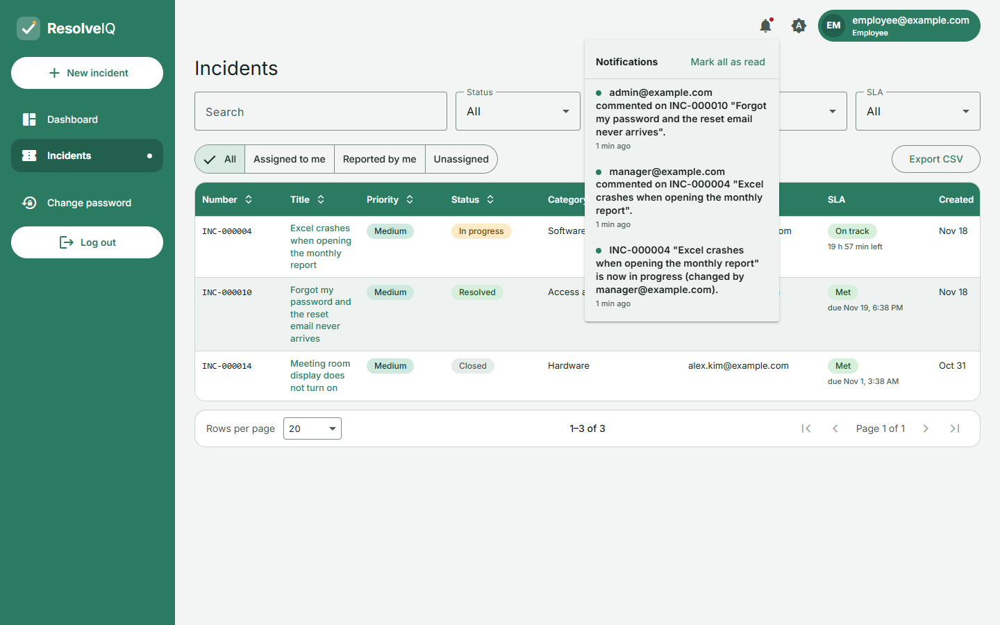

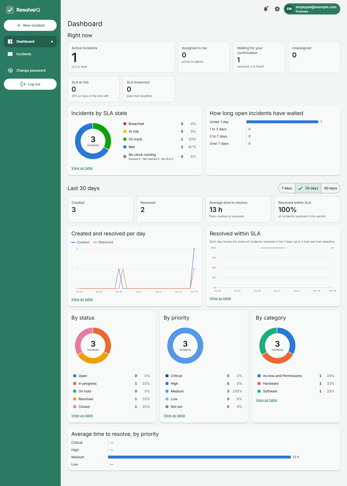

---

### Manager: "I decide who does what, and I keep things on time"

**Purpose:** triage, assign, set priority and watch deadlines. A Manager sees **every incident**, and can do everything an Employee can.

| What they do | Detail |
|---|---|
| **See everything** | Every incident, with the extra **Assignee** filter and the **Unassigned** toggle, so new reports are easy to find. |
| **Assign** | Pick the assignee and, for a first assignment, the **priority**. The dialog shows the reporter's urgency hint. Assigning **starts the SLA clock**. |
| **Reassign** | Hand an incident to someone else. The new assignee is notified, and the history records the move. |
| **Change priority** | While the incident is still being worked. This restarts the SLA clock with the new priority's hours. |
| **Watch the deadline** | Every incident shows **"Time left"**, or **"Overdue by 1 d 8 h"** in red. The list and the dashboard show At risk and Breached counts. |
| **Step in** | Make any valid status move on someone's behalf (start, hold, resolve, close, reopen). |
| **Tidy files** | See every incident's files, and remove any file (for example one attached by mistake). The history records the removal. |
| **Read the dashboard** | Everything below, including the **Workload by assignee** table (active and breached incidents per person). |
| **Export a CSV** | The current list, with the same filters, ready for Excel (see [Security](#8-security) for how it is made safe). |

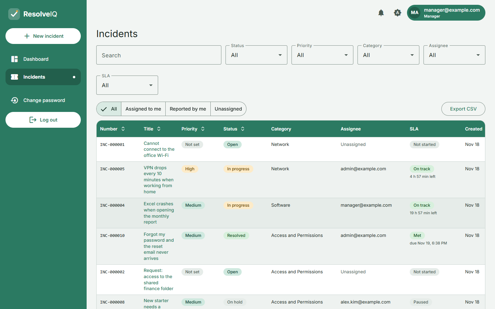

| An overdue incident | Assigning an incident |
|---|---|
| 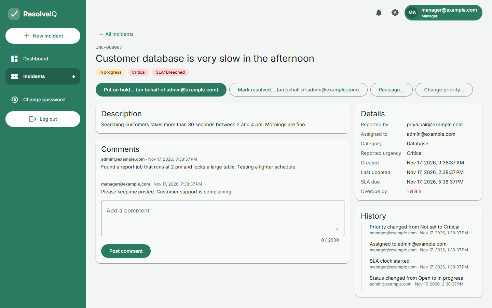 | 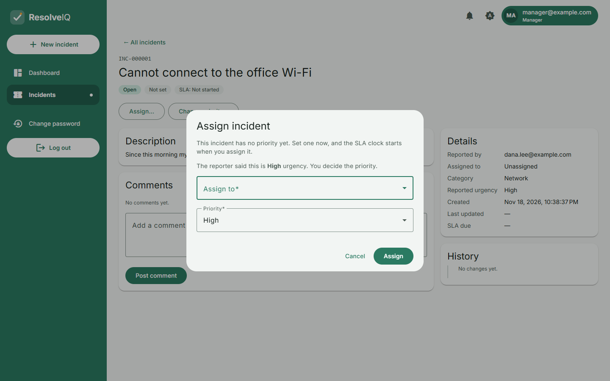 |

**The dashboard**

| Section | What it shows |
|---|---|
| **Right now** | Active incidents, assigned to me, waiting for your confirmation, unassigned (and how long the oldest has waited), SLA at risk, SLA breached. |
| **Incidents by SLA state** | A donut chart with counts and percentages. |
| **How long open incidents have waited** | Under 1 day, 1 to 3 days, 3 to 7 days, over 7 days. |
| **Last 7 / 30 / 90 days** | Created, resolved, average time to resolve, and the share resolved within SLA. |
| **Charts** | Created and resolved per day, resolved-within-SLA trend, by status, by priority, by category, average time to resolve by priority. |
| **Workload by assignee** | Managers and Admins only. |

Every chart has a **View as table** link, so the numbers are also available without the picture.

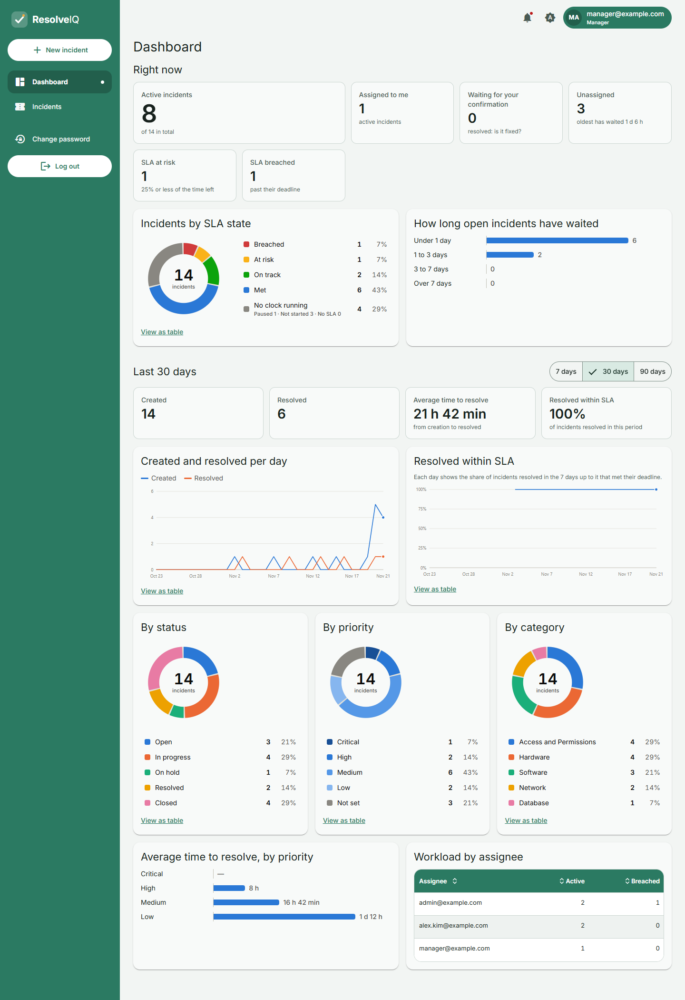

---

### Admin: "I look after the system and the people in it"

**Purpose:** manage users, categories and SLA deadlines, and see who changed what. An Admin can do everything a Manager can, plus the **Admin** area.

| Area | What an Admin can do |
|---|---|
| **Users** | **Create** a user (they get an emailed link to choose their own password; nobody, not even the Admin, ever sees a password). **Change role** (Employee, Manager, Admin; nobody can change their own role). **Send a password-reset email.** **Deactivate / reactivate.** Search by email. See each person's **active incidents**. |
| **Deactivate safely** | Deactivating someone who still has unfinished incidents shows how many, and asks whether to **hand them to someone else** (with a notification and a history line each) or leave them. The person is signed out at once and cannot sign in until reactivated. Nobody can deactivate themselves. |
| **Categories** | Create, rename, and **hide / show** categories (Hardware, Software, Network, Access and Permissions, Database, Other to start). Hidden categories disappear from the report form, but old incidents keep theirs. |
| **SLA policies** | Change the hours for each priority, or switch a priority's deadline off. Existing incidents keep the deadline they were given. |
| **Audit log** | Who did what in the Admin area, newest first, with search and an action filter. See below. |

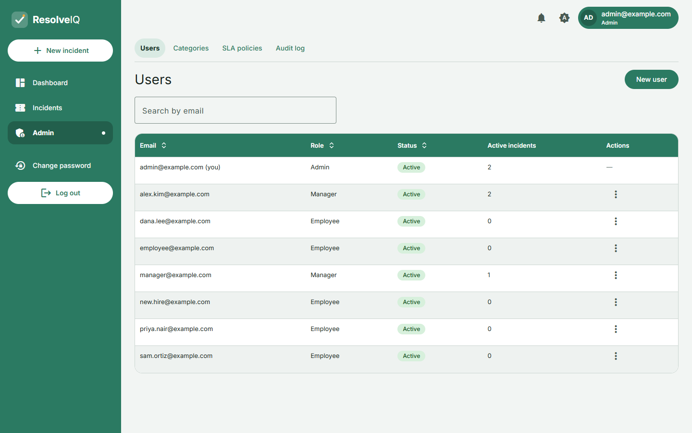

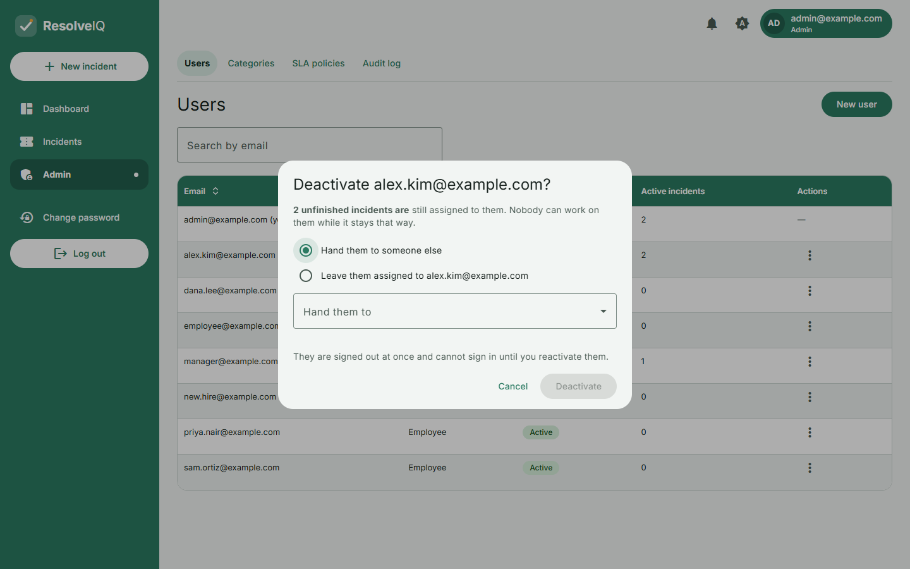

| Categories | SLA policies |
|---|---|
| 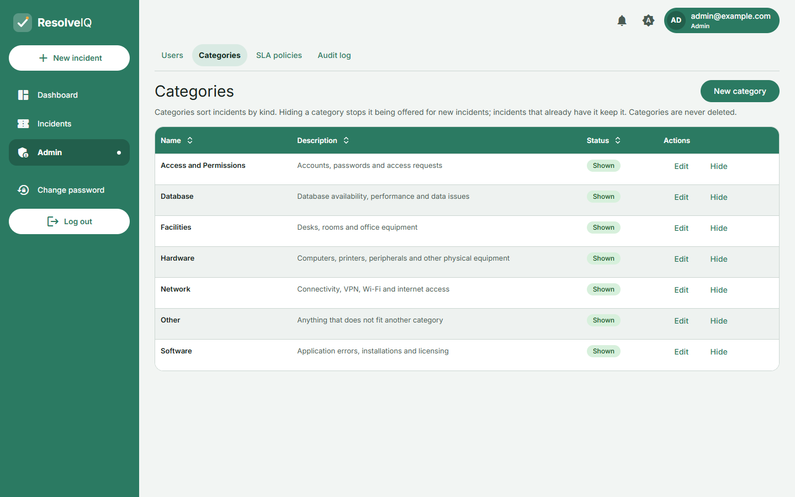 | 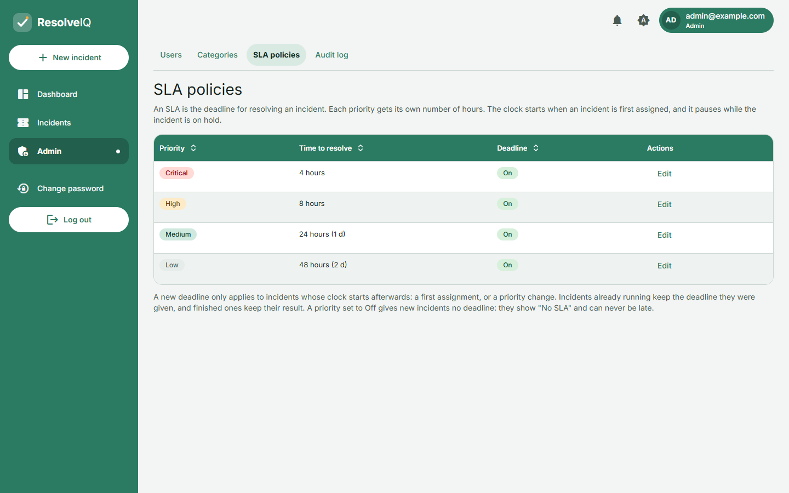 |

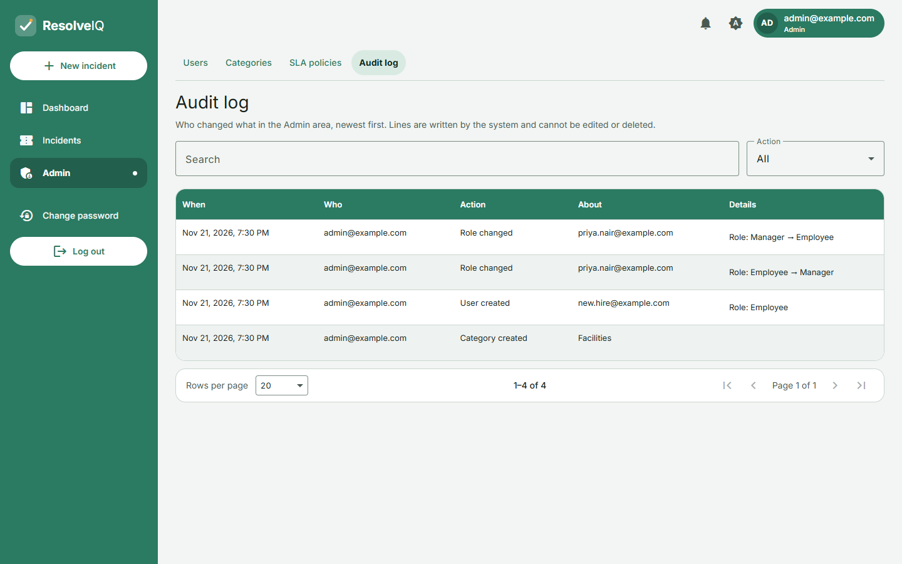

**The audit log** records: user created, user registered, role changed, user deactivated, user reactivated, reset email sent, category created, category updated, and SLA policy updated. Each line stores **who** did it (their email is saved on the line, so it stays readable even if the account is later deactivated), **what**, **to whom or what**, and **when**. Lines are written by the system and cannot be edited or deleted. Changes to individual incidents are recorded separately, in each incident's own **History**.

---

## 5. Who can do what

The server enforces every row. Hiding a button in the screen is only a convenience, and the permission tests check each of these against the real API.

| | Employee | Manager | Admin |
|---|:---:|:---:|:---:|
| Report an incident | ✅ | ✅ | ✅ |
| See incidents | Own only | All | All |
| Edit title and description | Their own report, until closed | Their own report | Their own report |
| Comment on an incident they can see | ✅ | ✅ | ✅ |
| Attach files (when the site allows it, and the incident is not closed) | On incidents they can see; on their own comments | On incidents they can see; on their own comments | On incidents they can see; on their own comments |
| Download a file | On incidents they can see | All | All |
| Remove a file (not on a closed incident) | Their own | Any | Any |
| Start work, hold, resolve | If assigned to them | ✅ (on behalf) | ✅ (on behalf) |
| Close or reopen a resolved incident | If they reported it | ✅ (on behalf) | ✅ (on behalf) |
| Assign, reassign | ❌ | ✅ | ✅ |
| Change priority | ❌ | ✅ | ✅ |
| Dashboard | Their own numbers | Everything, plus workload | Everything, plus workload |
| Export CSV | What they can see | All incidents | All incidents |
| Notifications bell | ✅ | ✅ | ✅ |
| Change own password | ✅ | ✅ | ✅ |
| See the user list (to pick an assignee) | ❌ | ✅ | ✅ |
| Create / change role / deactivate users | ❌ | ❌ | ✅ |
| Manage categories | ❌ | ❌ | ✅ |
| Change SLA policies | ❌ | ❌ | ✅ |
| View the audit log | ❌ | ❌ | ✅ |

---

## 6. Every feature, by area

### Incidents

- Report with title, description, optional category and optional reporter urgency.
- Automatic incident numbers (`INC-000001`, `INC-000002`, ...), generated by a database sequence so two people can never get the same number.
- Statuses: Open, In progress, On hold, Resolved, Closed. Priorities: Critical, High, Medium, Low (or "Not set" until a manager triages it).
- **Search** by number, title or description. **Filter** by status, priority, category, assignee and SLA state. **Quick views**: All, Assigned to me, Reported by me, Unassigned. Sort, page (20, and other sizes) and share the filtered view as a link.
- **Incident page:** description, details (reporter, assignee, category, reported urgency, dates, SLA due, time left or overdue by), **How it was fixed**, comments and a full **history** of every change.
- **Two people editing at once is safe.** Every incident carries a version stamp. If someone else saved first, the second save is refused instead of silently overwriting.
- **Resolution notes:** resolving requires saying how it was fixed. Holding requires saying why. Both are kept in the history.
- **Auto-close:** a background job runs every hour and closes incidents that have sat in *Resolved* for 7 days with no answer. It notifies the reporter and the assignee, and writes a history line.
- **CSV export** of the filtered list: up to 5,000 rows, UTF-8 so Excel shows accents correctly, and a header tells the screen if the list was cut short.

### File attachments

- **Attach files** to an incident (while reporting it, or later from its **Attachments** card) or to a **comment** (they are sent right after the comment is saved, and show under it).
- **What is allowed:** pictures (`.png` `.jpg` `.jpeg` `.gif` `.webp`), `.pdf` and plain `.txt`. At most **5 MB** a file, **5 files** on a comment and **20** on an incident. All of these can be changed in settings.
- **Checked twice.** The web app warns about a wrong kind or a file that is too big before anything is sent; the server then checks **again** and looks at the file's real first bytes, so a program or script renamed to `cute.png` is refused.
- **Download or remove:** any file on an incident a person can see can be downloaded. The person who attached it, and any Manager or Admin, can remove it. Both adding and removing a file show up in the incident's **History**, and a file attached to the incident (not to a comment) tells the reporter and the assignee in the bell.
- **Closed incidents are frozen:** no files can be added or removed, but the existing ones can still be downloaded.
- **Safe by design:** see [Security](#8-security). On a public demo site, attaching is switched off unless you turn it on.

### SLA and deadlines

- Deadline per priority, editable by an Admin. Clock starts at first assignment, restarts on a priority change, and pauses on hold.
- Seven states (Not started, On track, At risk, Paused, Breached, Met, No SLA) shown as coloured badges, with **"3 h 12 min left"** or **"Overdue by 1 d 8 h"**.
- Each incident stores the hours it was promised, so changing the policy never rewrites the past.

### Dashboard

- Live numbers ("Right now") and a period view (7, 30 or 90 days).
- Donut charts, line charts and bar charts, each with a **View as table** alternative.
- Workload per assignee for Managers and Admins.
- The numbers a person sees are always limited to the incidents they are allowed to see.

### Notifications

- A bell with an unread dot, a list that can be marked **read** one at a time or **all at once**, and a refresh once a minute while the page is visible.
- Kinds: **Assigned, Reassigned, Status changed, Resolved, Reopened, Closed, Comment, Priority changed, Closed automatically, and general information.**
- A notification is saved **in the same database transaction** as the change that caused it, so you can never get one for something that did not happen, or miss one for something that did.
- People only ever see their own.

### Administration

- Users, categories, SLA policies and the audit log (see [Admin](#admin-i-look-after-the-system-and-the-people-in-it)).
- **Registration controls:** registration can be switched off completely, or limited to certain email domains (for example only `@yourcompany.com`).
- Hand-over of unfinished incidents when deactivating someone (it either fully succeeds or changes nothing).

### Accounts and sign-in

- Sign in, **register** (when allowed), **change password**, **forgot password** and **reset password** by emailed link.
- Password rules: at least 8 characters, with an upper-case letter, a lower-case letter, a digit and a symbol.
- Sessions use a short-lived access token (15 minutes) plus a **rotating refresh token** (7 days), so people stay signed in without a long-lived key sitting in the browser.
- Changing a password, changing a role or deactivating someone **ends that person's existing sessions at once**.
- Repeated wrong passwords temporarily lock the account.
- If a session ends, the sign-in page says so, instead of just appearing.

### Comfort and quality

- **Light, Dark and System theme**, remembered between visits.
- **Works on a phone** (the menu folds away and the filters stack).
- **Accessible:** every screen is checked with an automated WCAG 2.1 A and AA scan (axe) in the browser tests, and every chart has a table alternative. The scan found real colour-contrast problems in the sidebar during development, which were fixed.
- **Unsaved-changes warning:** leaving a half-written form or comment asks first, and closing the tab does too.
- A proper **"Page not found"** page.
- Plain-language error messages, and a clear message when the server cannot be reached.

| Dark mode (the dashboard) | On a phone |
|---|---|
| 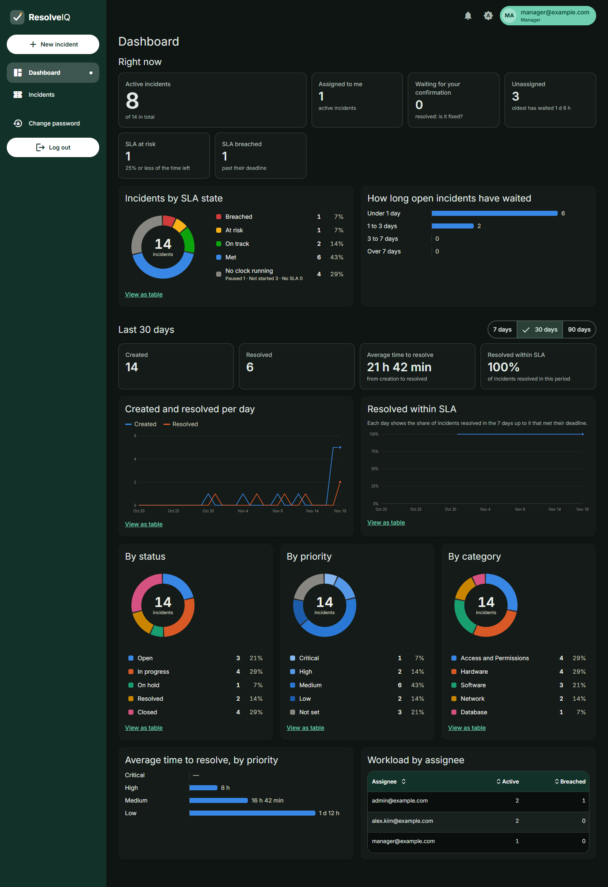 | 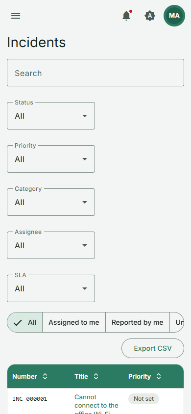 |

---

## 7. Architecture

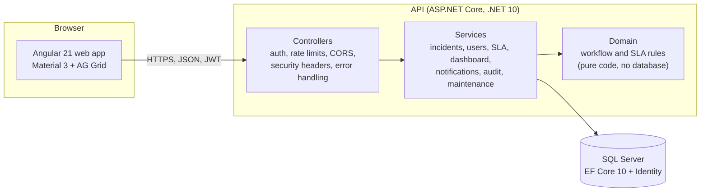

**Four layers, each only depending on the one below it:**

| Layer | Holds | Why it is separate |
|---|---|---|
| **API** | Controllers, JWT sign-in setup, rate limiting, CORS, security headers, error handling, health check, background jobs, startup seeding. | The only layer that knows about HTTP. |
| **Application** | Request and response shapes (DTOs), validation, the interfaces the services implement. | Describes *what* the app does without saying *how*. |
| **Domain** | Entities, the incident **workflow rules** and the **SLA calculator**. Pure code: the current time is passed in, and there is no database. | The business rules can be tested in milliseconds, and cannot be bypassed by a controller. |
| **Infrastructure** | EF Core, ASP.NET Identity, the services, email (log-only), migrations. | The only layer that knows about SQL Server. |

**The web app** uses standalone Angular components and signals, lazy-loaded screens for each area, one shared data-grid wrapper (AG Grid) with consistent badges and footers, an HTTP interceptor that attaches the token and refreshes it once when it expires, and route guards for sign-in, roles and unsaved changes.

### Data model

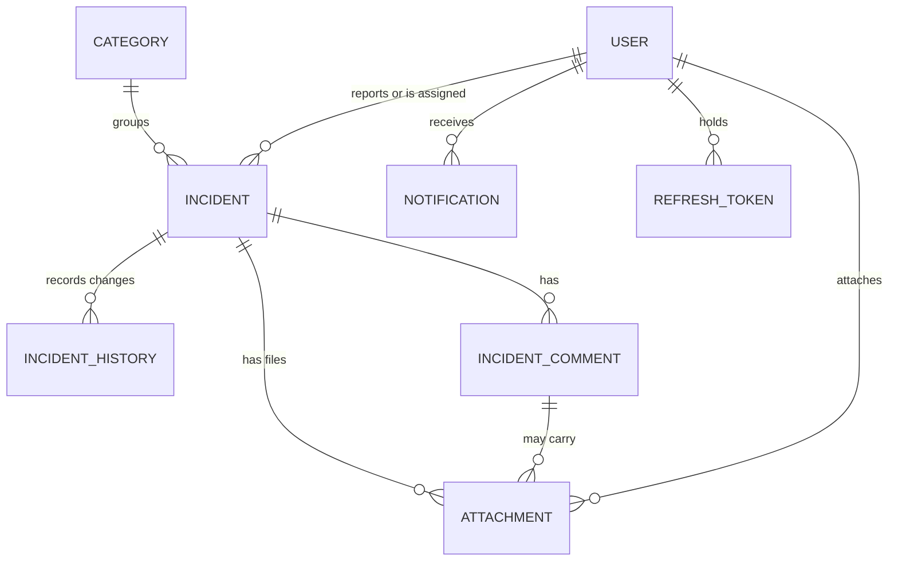

The **SLA policy** table holds the hours for each priority; an incident copies the hours it was promised when its clock starts, so it is not linked to the policy afterwards. The **audit log** table is deliberately not linked to users (see below).

Design choices worth knowing:

- **History, comments, notifications and the audit log are append-only.** No screen or endpoint edits or deletes them.
- **The audit log has no link to the users table.** It stores the actor's email on each line, so deleting or deactivating an account never rewrites or removes the record of what that person did.
- **Counters (`Sequence` columns) order events that happen in the same instant**, so history and comments always read in the order they really happened.
- **A change and its history lines are saved in one transaction**: all of it or none of it.
- **A file's bytes are stored in the database** (a `varbinary(max)` column), so one backup covers everything. Listing files reads only their details, never their bytes; the bytes are read only when someone downloads a file.
- **Refresh tokens are stored hashed**, rotated on every use, and cleaned up by the background job.

### Background job

An hourly job (it can be switched off or timed differently) closes long-resolved incidents, and deletes expired refresh tokens and old notifications. In tests each job is run directly, never on a timer.

---

## 8. Security

| Area | What is in place |
|---|---|
| **Permissions** | Enforced **on the server** for every endpoint and every incident. An Employee asking for someone else's incident gets "not found", not "forbidden", so they cannot even learn it exists. |
| **Sign-in** | ASP.NET Identity with hashed passwords, JWT access tokens (15 min) and rotating, hashed refresh tokens (7 days). A **security stamp** ends old tokens immediately after a password change, role change or deactivation. |
| **Brute force** | Repeated wrong passwords lock the account for a while. Sign-in, register, refresh and password-reset calls are **rate limited per visitor address** (20 a minute), and everything else is limited too (600 a minute), with a `429` and a `Retry-After`. |
| **No account guessing** | "Forgot password" gives the same answer whether or not the address has an account. A bad reset link gives the same answer as an unknown address. |
| **Password reset** | Links work once and expire after an hour. |
| **New users** | An Admin-created account starts with a random password nobody sees. The person chooses their own through the emailed link. |
| **Registration** | Can be closed, or limited to chosen email domains. |
| **Browser safety headers** | `X-Content-Type-Options`, `X-Frame-Options: DENY`, `Referrer-Policy: no-referrer`, a strict `Content-Security-Policy` for the API, `Permissions-Policy`, and HSTS in production. Sign-in answers are never cached. |
| **CORS** | Only the exact website addresses listed in settings, never "any origin". |
| **File attachments** | Only a short list of kinds is allowed (pictures, PDF, plain text; **no** programs, scripts, web pages or SVG). A file is accepted only if its extension **and** its real first bytes agree, so a renamed file is refused. The app picks the content type itself and cleans the file name (no folders, no odd characters). Files are always sent as **downloads** (never opened inside the page) with `nosniff` and no caching. They are exactly as private as the incident they belong to: someone who cannot see the incident gets "not found". Sizes and counts are capped, and on a public demo site uploads are **off by default**. |
| **CSV export** | Cells that begin with `=`, `+`, `-`, `@`, tab or a line break get a leading `'`, so a malicious incident title cannot run as a spreadsheet formula. Fields are quoted and escaped. |
| **Secrets** | Never in the code. Signing key, connection string and admin password come from user secrets or environment variables. The API refuses to start without a signing key. |
| **Docs and errors** | The interactive API docs (Swagger) exist only in Development. Error responses never include stack traces in production. |
| **Dependencies** | `npm audit` and a .NET vulnerable-package scan run on every push. |
| **Concurrency** | Version stamps stop two people silently overwriting each other. |

---

## 9. Testing and quality checks

| Suite | What it covers | Size |
|---|---|---|
| **Back end** (xUnit) | Business rules, every endpoint through the real API against a real, throwaway SQL Server database, the permission matrix (every role against every endpoint), SLA maths with a fake clock, rate limiting, audit log, hand-over, CSV, file attachments, demo-account protection, and more. | **606 tests** |
| **Front end** (Vitest) | Components, services, guards, interceptors, formatting and validation. | **749 tests** |
| **Browser** (Playwright) | The real API and the real web app driven like a person: sign-in, a full incident from **report to assign to resolve to confirm**, who-sees-what, the unsaved-changes warning, the audit log, the CSV download, and **attaching, downloading and removing files**. Plus an **axe accessibility scan** (WCAG 2.1 A and AA) of every main screen. | **16 tests** |

**Continuous integration** (GitHub Actions) runs on every push:

1. **Back end:** build, run the tests, scan packages for known vulnerabilities.
2. **Front end:** lint (ESLint with Angular's accessibility rules), `npm audit`, run the tests, production build.
3. **Browser tests:** start a real SQL Server, build the database, start the API and the web app, and run Playwright.

---

## 10. Run it on your computer

**You need:** the [.NET 10 SDK](https://dotnet.microsoft.com/download), [Node.js 20 or newer](https://nodejs.org/), and SQL Server (**LocalDB** comes with Visual Studio, or use any SQL Server). The commands below are for Windows with LocalDB; for another SQL Server, change the connection string.

### 1. Get the code

```bash
git clone https://github.com/gademeghana20/ResolveIQ.git
cd ResolveIQ
```

### 2. Start the API (port 5293)

Secrets are stored outside the code, with .NET user secrets:

```bash
cd backend/ResolveIQ.API
dotnet user-secrets set "Jwt:Key" "any-random-text-at-least-32-characters-long"
dotnet user-secrets set "Seed:AdminEmail" "you@example.com"
dotnet user-secrets set "Seed:AdminPassword" "A-strong-password-1!"
dotnet user-secrets set "Seed:DemoPassword" "A-strong-password-1!"   # creates admin/manager/employee@example.com
dotnet user-secrets set "Seed:DemoData" "true"                        # optional: 14 made-up incidents and 4 extra people
dotnet user-secrets set "Database:MigrateOnStartup" "true"            # builds the database tables for you
dotnet run --launch-profile http
```

Passwords need at least 8 characters, with an upper-case letter, a lower-case letter, a digit and a symbol.
The API now answers at <http://localhost:5293>, and `http://localhost:5293/health` should say `Healthy`. In Development there is also interactive API documentation at `http://localhost:5293/swagger`.

The default connection string uses LocalDB and a database called `ResolveIQDb`. To change it, set `ConnectionStrings:DefaultConnection` the same way.

> Prefer to build the tables yourself? Skip `Database:MigrateOnStartup` and run, from `backend`:
> `dotnet ef database update --project ResolveIQ.Infrastructure --startup-project ResolveIQ.API`

### 3. Start the web app (port 4200)

In a second terminal:

```bash
cd frontend
npm ci
npm start
```

Open <http://localhost:4200> and sign in with `admin@example.com`, `manager@example.com` or `employee@example.com` and the `Seed:DemoPassword` you chose.

> `npm start` uses an empty `config.js` (`frontend/src/dev-config`), so it always talks to **your** API on port 5293 and never to the live demo.

### 4. Run the tests

```bash
dotnet test backend/ResolveIQ.Tests          # needs SQL Server; makes and drops its own throwaway databases
cd frontend && npm test                      # front-end tests
cd e2e && npm ci && npx playwright install chromium && npx playwright test
```

The browser tests start their own API and web app on a throwaway database called `ResolveIQ_E2E`, and need **port 5293 to be free** (stop your own API first). On a computer with Microsoft Edge you can skip the browser download with `E2E_BROWSER=msedge`.

---

## 11. Settings reference

Every setting can go in `appsettings.json`, in user secrets, or in an environment variable (write `Seed:DemoPassword` as `Seed__DemoPassword`).

| Setting | What it does | Default |
|---|---|---|
| `ConnectionStrings:DefaultConnection` | The SQL Server database | LocalDB `ResolveIQDb` |
| `Jwt:Key` | **Secret.** Signs login tokens. At least 32 characters. **The API will not start without it.** | none |
| `Jwt:ExpiryMinutes` / `Jwt:RefreshTokenDays` | How long an access token and a refresh token last | 15 / 7 |
| `Seed:AdminEmail` / `Seed:AdminPassword` | Creates the first Admin, once, when there is none | none |
| `Seed:DemoPassword` | In Development: creates the three demo accounts with this password | none |
| `Seed:DemoUsers` | Creates the demo accounts outside Development too (for a public demo) | `false` |
| `Seed:DemoData` | Adds 14 made-up incidents and 4 extra people, **only into a database with no incidents** | `false` |
| `Demo:ProtectAccounts` | The three shared demo accounts cannot be locked, demoted or given a new password | `false` |
| `Registration:Enabled` | Whether anyone can create an account | `true` |
| `Registration:AllowedEmailDomains` | Limit registration to these domains (empty means any) | empty |
| `RateLimiting:AuthPermitLimit` / `GeneralPermitLimit` | Calls a minute per visitor address | 20 / 600 |
| `Maintenance:Enabled` / `IntervalMinutes` | The hourly housekeeping job | `true` / 60 |
| `Maintenance:AutoCloseResolvedAfterDays` | Days before an unanswered resolved incident closes itself | 7 |
| `App:FrontendUrl` | Where the web app lives (emailed links point here) | `http://localhost:4200` |
| `Cors:AllowedOrigins` | The web addresses allowed to call the API | `http://localhost:4200` |
| `Attachments:Enabled` | Whether people may attach files. Left unset it is **on**, except on a public demo (`Demo:ProtectAccounts`), where it is **off**. Existing files can always be downloaded. | unset |
| `Attachments:MaxFileBytes` | The biggest single file (never above 10 MB, whatever you set) | 5 MB |
| `Attachments:MaxFilesPerIncident` / `MaxFilesPerComment` | How many files an incident, or one comment, may hold | 20 / 5 |
| `Hosting:TrustProxyHeaders` | Behind a hosting proxy: read each visitor's real address (so rate limits work per person) | `false` |
| `Database:MigrateOnStartup` | Let the app build and update its own tables on start | `false` |

The web app has its own small file, `frontend/public/config.js`, with two public settings: `apiBaseUrl` (where the API lives) and `demoPassword` (shows the demo buttons). It must never hold a secret.

---

## 12. Deploying it

The live demo runs as two free pieces:

- **Website:** [Vercel](https://vercel.com), building the `frontend` folder (see `frontend/vercel.json`).
- **API and database:** [MonsterASP.NET](https://www.monsterasp.net/)'s free plan (.NET 10 and SQL Server), over HTTPS.

**[docs/DEPLOY.md](docs/DEPLOY.md)** is a click-by-click guide, including the problems met on the way (a 64-bit-only build that would not start, and the certificate that took minutes to appear) and how to reset the demo.

---

## 13. Project layout

```
ResolveIQ/
├─ backend/
│  ├─ ResolveIQ.API/             Controllers, startup, sign-in, rate limits, security headers
│  ├─ ResolveIQ.Application/     DTOs, validation, service interfaces
│  ├─ ResolveIQ.Domain/          Entities, incident workflow, SLA calculator (pure code)
│  ├─ ResolveIQ.Infrastructure/  EF Core, Identity, services, migrations, seeders
│  └─ ResolveIQ.Tests/           606 tests
├─ frontend/                     Angular app (features: incidents, dashboard, admin, auth, account)
├─ e2e/                          Playwright browser tests, and the screenshot script
├─ docs/
│  ├─ DEPLOY.md                  How to put it online
│  ├─ screenshots/               The images in this file
│  └─ postman/                   Postman collection and environment
├─ tools/make-postman.js         Builds the Postman collection from the live API description
└─ .github/workflows/ci.yml      The automated checks
```

---

## 14. API and Postman

Interactive documentation (Swagger) is available at `/swagger` when the API runs in Development. A ready-made **Postman collection** (41 requests in 8 folders, plus a 13-step guided tour) is in [`docs/postman`](docs/postman). Import both files, fill in the `email` and `password` of a demo account, and run the first request.

| Area | Endpoints |
|---|---|
| **Auth** `/api/auth` | `POST login` · `POST register` · `GET registration` · `POST refresh-token` · `POST logout` · `POST change-password` · `POST forgot-password` · `POST reset-password` |
| **Incidents** `/api/incidents` | `GET` (search, filter, sort, page) · `GET export` · `GET {id}` · `POST` · `PUT {id}` · `PUT {id}/assign` · `PUT {id}/status` · `PUT {id}/priority` · `GET {id}/history` |
| **Comments** | `GET` / `POST /api/incidents/{id}/comments` |
| **Attachments** | `GET /api/attachments/settings` · `GET /api/incidents/{id}/attachments` · `POST /api/incidents/{id}/attachments` (a form with the field `file`, and optionally `commentId`) · `GET /api/attachments/{id}/download` · `DELETE /api/attachments/{id}` |
| **Dashboard** | `GET /api/dashboard/summary` · `GET /api/dashboard/incident-statistics` |
| **Notifications** | `GET /api/notifications` · `PUT {id}/read` · `PUT read-all` |
| **Categories** | `GET` · `POST` (Admin) · `PUT {id}` (Admin) |
| **SLA policies** | `GET` (Manager, Admin) · `PUT {priority}` (Admin) |
| **Users** (Admin; list also for Manager) | `GET` · `GET {id}` · `POST` · `PUT {id}/role` · `POST {id}/password-reset-email` · `PUT {id}/active` |
| **Audit** | `GET /api/audit` (Admin) |
| **Health** | `GET /health` (open, answers only `Healthy` or `Unhealthy`) |

---

## 15. Known limits, and what was left out on purpose

**Limits you should know about**

- **No real email is sent.** Emails (welcome links, password resets) are written to the application log by a `LoggingEmailSender`. Replacing that one class with an SMTP or API sender would deliver real mail; every flow is already built and tested around it. For that reason **forgot password** is switched off for the demo accounts, and the demo has registration closed.
- **The live demo is on free hosting**, so the first visit after a quiet period is slow, and size and CPU limits are small.
- **Everybody shares the demo accounts**, including a working Admin. The data is made up, and the shared accounts are protected. If it ever gets messy, the database can be wiped and the app re-adds the demo data on its next start.
- **Notifications refresh once a minute** (while the page is visible). They are not pushed instantly.
- **Attachments live in the database.** That keeps one backup for everything and needs no file storage, but it fills a small (free) database faster, so the default limits are modest. There is **no virus scanning** and no picture preview, only downloads. They are switched off on the live demo.
- **Single organisation**, English only.
- **Tokens live in the browser's storage**, the usual trade-off for a single-page app. The short access-token life, rotating refresh tokens and the strict browser headers limit the damage if one is ever stolen.

**Left out on purpose** (each would weaken the audit trail or add risk for little value)

- **Deleting an incident.** Incidents are closed, never erased, so the record stays complete.
- **Editing a user's email or details** (`PUT /api/users/{id}`). Identity is changed only through the safe flows above.
- **Creating a new SLA priority** (`POST /api/sla/policies`). The four priorities are fixed; an Admin changes their hours.
- **Editing or deleting comments, history and audit lines.**

---

## 16. Licence

[MIT](LICENSE). Free to use, copy and change, as long as the licence notice stays.

This is a personal portfolio project, built from scratch for learning. It contains no employer code, credentials or data, and every person and incident in the demo is invented.

*Screenshots in this file are generated by [`e2e/scripts/take-screenshots.js`](e2e/scripts/take-screenshots.js), which drives the real app against a throwaway database with made-up data.*
